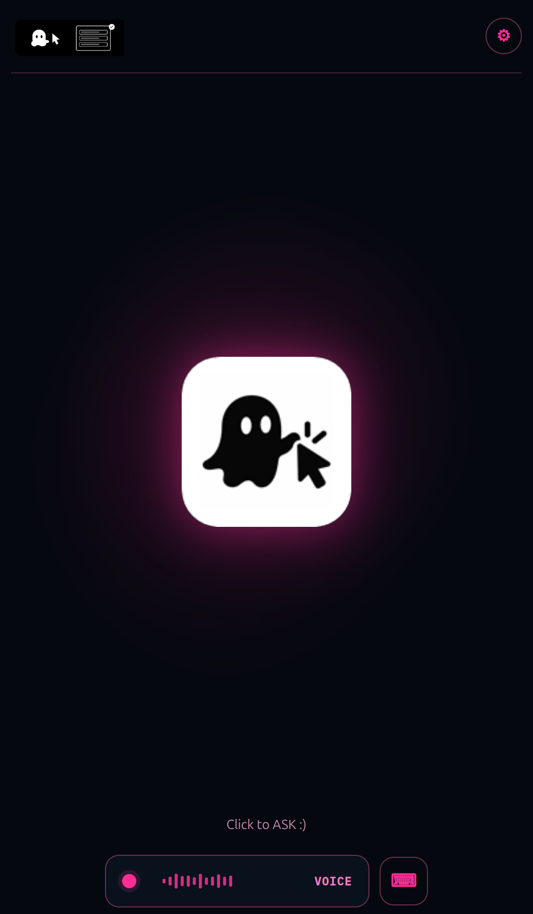

<p align="center">
  
</p>

<h1 align="center">Ghostclick</h1>

<p align="center"><b>Tell your browser what you want done. A local AI does it, step by step, and asks before anything that matters.</b></p>

---

Ghostclick is a Chrome extension with a local AI browser agent. Describe a task in plain words and the agent looks at the page, picks one action at a time, checks the result, and keeps going across pages and tabs. It can also record a task you show it once and replay it with new values, scrape lists, and read PDFs.

> **Status (25 Oct 2026).** Chrome E2E for agent, Ask, tabs, and workflows is in good shape. Measured checks: [verifiedresults.md](verifiedresults.md).

The AI model ([WebLLM](https://github.com/mlc-ai/web-llm)) runs on your own graphics card. Your pages and data are never sent to a server, and no account or API key is needed. Optional voice input uses Chrome's speech service.

See **[DEMO.md](DEMO.md)** for the hackathon demo: a multi-page enterprise practice site with 13 graded automation challenges.

**Poster:** [canva.link/cbd1h9bidyjug36](https://canva.link/cbd1h9bidyjug36) · **Slides:** [canva.link/6gn42uw1ggqe10i](https://canva.link/6gn42uw1ggqe10i) · **Demo videos:** [Google Drive](https://drive.google.com/drive/folders/1T96NF83ThHsy3r5mKL45U8i7iUJs-FCq?usp=sharing)

## Install

A stable build on the [Chrome Web Store](https://chrome.google.com/webstore) is coming soon (one-click install, no Node). Until then, load from source as below.

You need [Node.js](https://nodejs.org) 20 or newer and Google Chrome. Install the **LTS** build from [nodejs.org](https://nodejs.org) (v20+); then `node -v` and `npm -v` should work in a new terminal. For Ask, agent, and Repair B/C, you also need a graphics card with WebGPU (most from the last few years). **Record and replay work without a model.** Node is only required to build; day-to-day use is just Chrome.

```bash
git clone https://github.com/Avanith12/GHOSTCLICK.git
cd GHOSTCLICK
npm install        # also generates WXT's types
npm run build
```

Then in Chrome:

1. Go to `chrome://extensions` and turn on **Developer mode** (top right).
2. Click **Load unpacked** and choose the `.output/chrome-mv3` folder inside the project (not the repo root).
3. Pin Ghostclick from the puzzle-piece icon, then click it to open the side panel.

Reload any tabs that were open before you installed it. After every `git pull`, run `npm install` and `npm run build` again, then **Reload** the extension at `chrome://extensions`.

### Updating on another computer

`git pull` only updates the **source code**. Chrome keeps running whatever you last **built**. On every machine:

```bash
cd GHOSTCLICK
git pull
npm install
npm run build
```

Then at `chrome://extensions` → Ghostclick → **Reload**.

- Always load / reload **`.output/chrome-mv3`** (not the repo root).
- **`npm install` is required** after pulls that add packages (for example OCR / `tesseract.js`). If you skip it, `npm run build` fails with “failed to resolve import …”.
- If the UI still looks old: remove the extension → **Load unpacked** again → pick `.output/chrome-mv3`.

### The demo site

```bash
npm run demo       # open http://127.0.0.1:4173 in Chrome
```

This serves **Northwind Works**, a fictional company app with a dashboard, employee directory, job application portal, product inventory, analytics, settings, and an **Automation Challenges** page that grades each task from the real page state. The original single-page practice form is still at `/advising.html`. Opening `demo/index.html` with VS Code's Live Server works too. Ghostclick only runs on `http(s)` pages — use the URL above; double-clicking the file (`file://`) will not work.

### Dev vs production build

| Folder | How you get it | Keep a terminal running? |
|--------|----------------|--------------------------|
| `.output/chrome-mv3` | `npm run build` | **No**: the extension works on its own |
| `.output/chrome-mv3-dev` | `npm run dev` | **Yes**: leave `npm run dev` running, or Chrome shows “Failed to connect to dev server” errors |

## How to use it

<p align="center">
  
</p>

The side panel opens on a home screen. Click the ghost or **Voice** to speak a request, or the keyboard button (⌨) to type one; both open **Ask** on the home screen (no mode tabs). Ghostclick routes the request: answer a page question, scrape or filter a list, run a saved workflow, read a PDF, or drive the page step by step with the agent. The **⚙ settings** button opens **Workflows** and **Data**, plus theme, the ghost pointer during replays, and the default model. Ask itself can send you into those screens when the request needs them (for example “read this PDF” → Data).

### Ask (home)

1. Speak or type a request and press **Go**. Examples:
   - *“What is this page about?”* / *“Summarize this page”* — answers from the current page (needs a text model)
   - *“Find the items related to AI”* / *“Get every item on this page”* — collects a list
   - *“Save this page as a clean document”* — downloads Markdown
   - *“Read the PDF in this tab”* — opens PDF tools in Data
   - *“Open my last 5 tabs”* / *“Restore my previous tabs”* — reopens recent websites you used (and recently closed ones)
   - *“How many tabs do I have open?”* — counts and lists open tabs
   - *“Which three are cheapest?”* — after you have scraped rows
   - *“go to example.com”* — opens that site (no model needed for plain open/go-to)
   - A sentence that matches a saved workflow fills in its values and offers **Run**
   - Page work with no matching workflow (*“Add one Lumen Air laptop to the cart”*) starts the agent
2. While the agent works, the home Ask area shows **Working…**, the plan and steps, and **Pause** / **Resume** / **Stop**. The on-page bar also has **Stop**.
3. Consequential actions wait for **Approve** or **Skip it**; login, captcha, upload, or missing info waits for **Continue**.
4. When the run ends, **Save as workflow** turns the steps into a normal workflow.

### Workflows: record and replay

1. Open **⚙ → Workflows**, then **Record this page**.
2. Do the task as usual: type, click, submit.
3. Click **Save workflow**.
4. To repeat it, open the workflow, change the values, and click **Run**, or upload a CSV to run it once per row.

### Data

Open **⚙ → Data** (or ask to read a PDF / scrape and Ask will open Data). **Scrape a list on this page**, then click one item. Ghostclick finds the rest. Download as CSV or JSON, download every linked file, save the page as Markdown, or ask questions about the rows. The agent's `EXTRACT` action fills the same table.

## Features

**Autonomous agent (from Ask on home)**
- A loop of plan → look at the page → choose one action → validate → approve if needed → act → check the result → repeat, with a final check that the goal is really met before it accepts “done”
- 24 schema-checked actions: `NAVIGATE`, `SEARCH`, `CLICK`, `TYPE` (optionally pressing Enter), `CLEAR`, `SELECT`, `SCROLL`, `HOVER`, `WAIT`, `READ`, `EXTRACT`, `NOTE`, `OPEN_TAB`, `SWITCH_TAB`, `CLOSE_TAB`, `GO_BACK`, `GO_FORWARD`, `DOWNLOAD`, `SUBMIT`, `UPLOAD_FILE` (asks you to pick the file), `SCREENSHOT`, `VERIFY`, `ASK_USER`, `FINISH`. The model only ever produces these JSON objects, never code.
- Page understanding: a compact, numbered list of visible controls with their accessible names, roles, values, options, checked state, link targets, required and invalid flags, plus open dialogs, error messages, password fields, captchas, and the page text most relevant to the goal. Element names follow accessibility rules (`aria-labelledby`, labels, `aria-label`, then text), so it handles custom dropdowns, switches, and modals, not just plain forms.
- Self-healing: if the page re-renders, a chosen element is found again from its recorded selectors. Invented ids, wrong control types, and blocked addresses are rejected with a reason the model reads next step.
- Loop prevention: repeating the same action on an unchanged page is refused, “the page did not change” is reported back, and four failures in a row end the run with an explanation. Configurable step limit (default 25) and a 90-second limit per model reply.
- Task memory: the goal, plan, completion criteria, notes, and recent actions carry across pages and tabs.

**Tabs**
- The model sees every open tab (title, site, which is current, which it opened, which still need permission) and decides itself when to switch, open, or close tabs
- Ask can reopen your last N websites (*“open my last 5 tabs”*) from sites you recently focused plus Chrome’s recently closed list, and can answer *“how many tabs are open”*
- Links that open a new tab are followed automatically
- Page content is read only on sites you allow. The site you start on is allowed; any other site asks once per task (**Allow for this task**, **Always allow**, **Don't allow**). You can keep lists of always-allowed and never-touch sites.
- Closing a tab the agent did not open needs your approval

**Safety**
- Never types passwords or card numbers, never solves captchas, never picks files for you
- Page text is given to the model as untrusted data, and the model is told never to follow instructions in it
- Only `http(s)` addresses can be opened; `javascript:`, `file:`, and browser pages are refused
- Visible Stop in the panel and on the page

**Record and replay**
- Record clicks, typing, checkboxes, and dropdowns as steps; passwords are never saved
- Replay with new values, or once per row of a CSV file
- Page checks (“the page should show *Request submitted*”) with pass/fail results
- Self-repair when a step’s control is missing or renamed (table below). Unchanged pages need no repair and no model. Cancel, Delete, and Log out are avoided
- Pauses at captchas so you can solve them, then continues

Self-repair ladder (cheapest first):

| Level | What runs | Example |
|-------|-----------|---------|
| 1 · Structural | Match by label / similar text on the page | Continue → Next |
| 2 · Text model | Local model picks among candidate controls | Suggests Next, not Cancel |
| 3 · Vision | Phi-3.5 Vision picks a numbered button on a screenshot | Icon-only button |
| 4 · Human | Asks you to choose (or pauses for a captcha) | Button removed |

**Data and documents**
- Scrape lists and tables to CSV or JSON, including lists that load more as you scroll
- Download all linked files (PDF, Word, Excel, ZIP, images) at once
- Save any article as clean Markdown
- Read PDFs from a tab or from disk, with on-device OCR for scanned pages; ask questions or pull values into a table, with values not found in the PDF flagged

## Technology

- **Chrome extension, Manifest V3**, built with [WXT](https://wxt.dev): a service worker for sessions, replay, and agent status; a content script that observes and acts in pages; a React 19 side panel
- **[WebLLM](https://github.com/mlc-ai/web-llm)** for on-device models over WebGPU, with grammar-constrained JSON output for the agent
- **pdf.js** for PDFs and **Tesseract.js** for on-device OCR
- **TypeScript**, **Vitest** with jsdom for unit tests, **Puppeteer** driving real Chrome for end-to-end tests
- The demo site is plain HTML, CSS, and JavaScript modules with seeded data and no backend

## The AI model

Choose a model in **Ask** (home) or in ⚙ settings. It downloads once from Hugging Face, then runs on your graphics card through WebGPU.

| Model | Download | Use it for |
|-------|----------|------------|
| Qwen2.5 1.5B | about 1 GB | Fastest — great for short Ask answers |
| Llama 3.2 3B | about 2 GB | A good balance for agent tasks |
| Phi-3.5 Mini | about 2.2 GB | The strongest text model here; the first choice for agent tasks |
| Phi-3.5 Vision | about 4 GB | Repairing replays from a screenshot |

Every action is validated, consequential steps need your OK, and “done” is double-checked. See [verifiedresults.md](verifiedresults.md) for measured runs. Recording, replay, scraping, and saving pages all work without a model.

## Project structure

```
entrypoints/
  background.ts           Session state, recording, replay, batch runs, agent status, saving agent runs
  content.ts              Runs in web pages: records, replays, scrapes, and answers the agent's observe/act messages
  sidepanel/              Side panel UI (home Ask, agent run view, Workflows, Data, settings)
  voice/                  The small Voice window
features/
  agent/                  The autonomous agent
    agentLoop.ts          Plan → observe → decide → validate → approve → act → verify loop, tabs, permissions
    actions.ts            Action schema, parsing, validation, approval rules, URL and site checks
    agentPrompt.ts        Compact prompts within a 3,072-token window
    observePage.ts        Page observation and action execution (runs in the content script)
    chromeBrowser.ts      Chrome tabs/scripting implementation of the loop's browser
  ask/                    Ask routing (page Q&A, scrape, workflows, agent, tabs, PDF)
  tabs/                   Recent-tab memory for “open my last N tabs”
  data/                   Scraping, Markdown, PDFs, OCR, questions about rows
  workflows/              Record/replay helpers, self-repair, captcha detection
  local-ai/               WebLLM loading and calls shared by all features
shared/                   Types, CSV, text helpers, tab reconnection
demo/                     Northwind Works demo site and the classic advising form (static, no backend)
browser-tests/            Real-Chrome tests (see Testing)
```

## Testing

```bash
npm test                                   # unit tests (vitest): agent loop, actions, prompts, page observation, Ask planner, tabs, scraping, PDFs
npx tsc --noEmit -p .                      # type check
npm run build                              # or: npx wxt zip, for a packaged .zip
CHROME_PATH="<path to chrome>" npm run test:demo    # demo site: every page, deep links, refresh, all 13 challenges by hand, scoring
CHROME_PATH="<path to chrome>" npm run test:agent   # the agent in real Chrome with the extension loaded (16 scenarios, scripted decisions)
# Real-model runs (need WebGPU; the first run downloads the model, about 2 GB, into .cache/):
CHROME_PATH="<path to chrome>" MODEL=Phi-3.5-mini-instruct-q4f16_1-MLC MAX_STEPS=12 node browser-tests/agent-bench.mjs
CHROME_PATH="<path to chrome>" MAX_STEPS=12 node browser-tests/public-bench.mjs
```

`test:agent` swaps the model for scripted decisions that read the real prompt, so it checks everything except the model's judgement: observation, element ids, validation, approvals, site permissions, tab switching, new-tab handling, Stop (panel and page), extraction, saving the run as a workflow, and replaying it without a model. Results are checked against the demo's own challenge grader. `test:live` (external websites) and `model-test.mjs` (real WebLLM models; needs a GPU and the model downloads) cover the older features. Recorded outcomes: [verifiedresults.md](verifiedresults.md).

## Team


- Avanith Kanamarlapudi
- Chelsea Nguyen
- Ana Maria Fahlböck
- Kurt Sooknanan
- Kalysha MelendezHernandez
- Ila Lama

## License

[MIT](LICENSE) © 2026 the Ghostclick team
